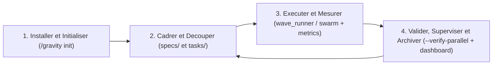

# Parcours utilisateur — De la découverte au multi-projets

Ce guide décrit le cycle complet d'utilisation de **Gravity**, du premier démarrage en solo jusqu'au pilotage multi-dépôts et la sauvegarde portable.

---

## 1. Vue d'ensemble du parcours

---

## 2. Scénario fil rouge annoté (Paliers 1 → 2 → 3)

1. **Palier 1 (*Essentiel* — solo sur un dépôt applicatif) :**
   - Vous installez `gravity` + `gravity-workflow`, puis exécutez `/gravity init` et `/gravity help`.
   - Vous travaillez sur une fonctionnalité avec `/gravity-workflow standard` (ou `quick` pour un correctif simple, `deep` pour une refonte risquée) et `/caveman lite` actif par défaut pour économiser des tokens. Les garde-fous `PreToolUse` bloquent les commandes destructrices sans modifier votre dépôt.
2. **Palier 2 (*Pilotage* — maîtriser coûts, cache et fiabilité) :**
   - Vous ajoutez `gravity-metrics`. Avant une session importante, vous lancez `/gravity-metrics start mon-lot` (`0` token LLM), basculez votre workflow sur `/gravity-workflow evo` et `/caveman auto`.
   - Les signaux `session-metrics` et `cost-telemetry` informent les suggestions d'adaptation (`evo`). En fin de lot, `/gravity-metrics stop` archive la capture de manière immuable.
3. **Palier 3 (*Multi-projets* — conception transversale, vagues natives & sauvegarde) :**
   - Vous ajoutez `gravity-architect`. Dans votre atelier dédié (ex. `gravity-studio`), `/gravity-architect spec` et `/gravity-architect task` préparent les briefs autonomes dans `specs/` et `tasks/` (`<= 5` fichiers code/task).
   - La production s'exécute à **100 % en natif Antigravity** sans sidecar externe : `run_workflow` (`wave_runner.py`, *fail-isolated* en `git worktree` détachés avec `Planner` sauté sur `plan_file`, routage `quick`/`standard` et watchdogs `900s`/`360s`) ou `/swarm` pour les chantiers couplés, puis validation parallèle des `4` dépôts (`audit_ecosystem.py --verify-parallel --strict`) et archivage (`/gravity-architect archive <slug>`).
   - À tout moment, `/gravity dashboard` (barre latérale gauche `Gravity` ou menu `+` du panneau latéral droit) consolide les `4` modules (`4` onglets dédiés + OCP) à **0 token**, et `/gravity export` / `/gravity import` sauvegardent ou restaurent `$GRAVITY_HOME` (et vos ateliers via `--include-atelier`).

---

## 3. Matrice des 4 phases

| Phase | Commande(s) clé(s) | Stockage `$GRAVITY_HOME` | Coût tokens | Résultat observable |
|---|---|---|---|---|
| **1. Installer & Initialiser** | `python scripts/ecosystem_install.py --install --tier <1\|2\|3>`, `/gravity`, `/gravity init`, `/gravity doctor` | `core/modules.json` + dossiers `<module>/` | `0` sur `/gravity` (`PreInvocation`) et CLI | Plugins validés (`--strict`), registre atomique créé, legacy détecté RO |
| **2. Cadrer & Découper** *(Palier 3)* | `/gravity-architect [init\|sync\|spec\|task]` | `architect/` + atelier Hot/Cold séparé | Faible (micro-delta `--print-delta`) | `ECOSYSTEM.md`, `specs/`, `tasks/`, `audits/code/` à jour |
| **3. Exécuter & Mesurer** *(Paliers 1→3)* | `run_workflow` (`wave_runner.py`), `/swarm`, `/gravity-workflow [quick\|standard\|deep\|evo]`, `/caveman`, `/gravity-metrics [start\|stop\|pending\|archive]` | `workflow/workspaces/<slug>-<hash>/`, `workflow/worktrees/`, `metrics/` | Optimisé (`Planner` sauté sur `plan_file`, `/caveman`, `0` sur `metrics start`) | Plan/Code/Revue isolée sur `git worktree`, patches vérifiés sur `dev`, métriques archivées |
| **4. Superviser, Valider & Sauvegarder** | `audit_ecosystem.py --verify-parallel --strict`, `/gravity dashboard` (ou barre latérale `Gravity` / menu `+`), `/gravity-architect archive`, `/gravity export`, `/gravity import` | Lecture seule transversale + `core/sync.json` + ZIP portable | `0` token interactif (MCP App & CLI export/import) | `4/4` dépôts validés en parallèle, vue unifiée `4` onglets + OCP, sauvegarde ZIP vérifiée SHA-256 |

---

## 4. Les 3 frontières d'or à retenir

1. **`gravity-studio` vs dépôts produits :**
   - La conception multi-projets (`ECOSYSTEM.md`, `specs/`, `tasks/`, fiches `tracking/`) vit dans un atelier séparé (ex. `gravity-studio`) — jamais dans les 4 dépôts plugins ni dans vos dépôts applicatifs.
2. **Branche `dev` vs branche `main` :**
   - Tout développement quotidien s'effectue sur `dev` (ou une branche dédiée). La fusion sur `main` et les tags `vX.Y.Z` sont réservés aux releases validées par le chef d'orchestre sur accord explicite.
3. **`audits/code/` vs `audits/agents/` :**
   - `audits/code/` appartient exclusivement aux audits Code & Architecture pilotés par **`gravity-architect`**.
   - `audits/agents/` appartient exclusivement aux audits de sessions/agents exploités par **`gravity-metrics`** (onglet *Audits Agents*). Les deux périmètres ne doivent jamais être mélangés.

**Voir aussi :** [Démarrage rapide](getting-started.md) · [Aide-mémoire des commandes](command-cheatsheet.md) · [Architecture](architecture.md)
