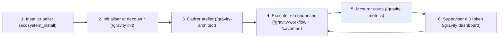

# Parcours utilisateur — De la découverte au multi-projets

Ce guide décrit le cycle complet d'utilisation de **Gravity**, du premier démarrage en solo jusqu'au pilotage multi-dépôts.

---

## 1. Vue d'ensemble du parcours

---

## 2. Scénario fil rouge annoté (Paliers 1 → 2 → 3)

1. **Palier 1 (*Essentiel* — solo sur un dépôt applicatif) :**
   - Vous installez `gravity` + `gravity-workflow`, puis exécutez `/gravity init` et `/gravity help`.
   - Vous travaillez sur une fonctionnalité avec `/gravity-workflow standard` (ou `quick` pour un correctif simple, `deep` pour une refonte risquée) et `/caveman lite` actif par défaut pour économiser des tokens. Les garde-fous `PreToolUse` bloquent les commandes destructrices sans modifier votre dépôt.
2. **Palier 2 (*Pilotage* — maîtriser coûts, cache et fiabilité) :**
   - Vous ajoutez `gravity-metrics`. Avant une session importante, vous lancez `/gravity-metrics start mon-lot` (`0` token LLM), basculez votre workflow sur `/gravity-workflow evo` et `/caveman auto`.
   - Les signaux `session-metrics` et `cost-telemetry` informent les suggestions d'adaptation (`evo`). En fin de lot, `/gravity-metrics stop` archive la capture de manière immuable.
3. **Palier 3 (*Multi-projets* — conception transversale et gouvernance) :**
   - Vous ajoutez `gravity-architect`. Dans votre atelier dédié (ex. `gravity-workshop`), `/gravity-architect spec` et `/gravity-architect task` préparent les spécifications et tâches traçables, puis `/gravity-architect archive <slug>` archive le chantier.
   - À tout moment, **Plugins -> Gravity** (`/gravity dashboard`) consolide les 4 modules en lecture seule sans consommer de tokens.

---

## 3. Matrice des 6 phases

| Phase | Commande(s) clé(s) | Stockage `$GRAVITY_HOME` | Coût tokens | Résultat observable |
|---|---|---|---|---|
| **1. Installation** | `python scripts/ecosystem_install.py --install --tier <1\|2\|3>` | Aucun (copie dans `~/.gemini/config/plugins/`) | `0` (CLI locale) | Plugins validés (`--strict`) et installés dans l'ordre topologique |
| **2. Initialisation** | `/gravity init`, `/gravity help`, `/gravity doctor` | `core/modules.json` + dossiers `<module>/` | Très faible (script local) | Registre atomique créé, modules découverts, legacy détecté RO |
| **3. Cadrage** *(Palier 3)* | `/gravity-architect [init\|sync\|spec\|task]` | `architect/` + atelier Hot/Cold séparé | Faible (micro-delta `--print-delta`) | `ECOSYSTEM.md`, `specs/`, `tasks/`, `audits/code/` à jour |
| **4. Exécution** *(Palier 1+)* | `/gravity-workflow [quick\|standard\|deep\|evo]`, `/caveman` | `workflow/workspaces/<slug>-<hash>/` | Optimisé (`/caveman` + profils) | Plan/Code/Revue isolée, hooks `PreToolUse` actifs, 0 pollution repo |
| **5. Capture & Coûts** *(Palier 2+)* | `/gravity-metrics [start\|stop\|pending\|archive]` | `metrics/{data/history.jsonl,METRICS.md,reports/}` | `0` sur `start` (`PreInvocation`) | Fenêtre capturée, jalons calculés, rapport archivé |
| **6. Supervision** | `/gravity dashboard` ou **Plugins -> Gravity** | Lecture seule transversale | `0` token interactif (MCP App) | Vue unifiée `En direct`, `Metrics`, `Architect`, `Overview` |

---

## 4. Les 3 frontières d'or à retenir

1. **`gravity-workshop` vs dépôts plugins :**
   - La conception multi-projets (`ECOSYSTEM.md`, `specs/`, `tasks/`, fiches `tracking/`) vit dans un atelier séparé (`gravity-workshop`) — jamais dans les 4 dépôts plugins ni dans vos dépôts applicatifs.
2. **Branche `dev` vs branche `main` :**
   - Tout développement quotidien s'effectue sur `dev` (ou une branche dédiée). La fusion sur `main` et les tags `vX.Y.Z` sont réservés aux releases validées par le chef d'orchestre sur accord explicite.
3. **`audits/code/` vs `audits/agents/` :**
   - `audits/code/` appartient exclusivement aux audits Code & Architecture pilotés par **`gravity-architect`**.
   - `audits/agents/` appartient exclusivement aux audits de sessions/agents exploités par **`gravity-metrics`** (onglet *Audits Agents*). Les deux périmètres ne doivent jamais être mélangés.

**Voir aussi :** [Démarrage rapide](getting-started.md) · [Aide-mémoire des commandes](command-cheatsheet.md) · [Architecture](architecture.md)
